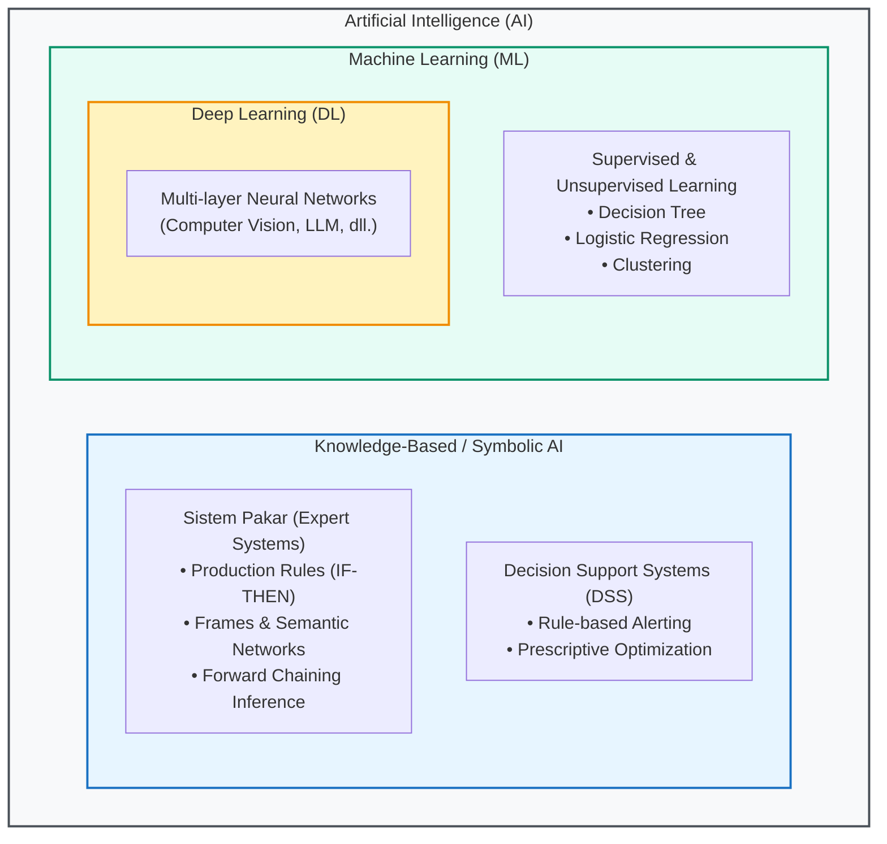
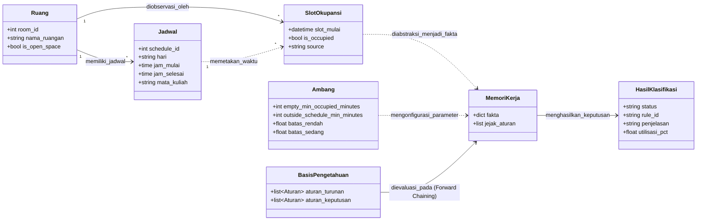

# Dokumen Rancangan AI (AI Design Document)

**Platform Analisis Pemanfaatan Ruang Bersama Berbasis AI (Smart Space Analytics Platform)**  
*Dokumen Acuan Teknis & Keterlacakan Materi Kuliah AI (IF316)*  
**Penyusun:** Rangga & Dika | **Sprint:** 1 (Inti AI) | **Branch:** `feature/ss1-13-dokumen-rancangan-ai`

---

## Daftar Isi
1. [Posisi Proyek dalam Ruang Lingkup AI (AI1)](#1-posisi-proyek-dalam-ruang-lingkup-ai-ai1)
2. [Representasi Pengetahuan & Arsitektur Sistem Pakar (AI2 & AI4)](#2-representasi-pengetahuan--arsitektur-sistem-pakar-ai2--ai4)
   - 2.1 [Representasi Pengetahuan Berbasis Frame](#21-representasi-pengetahuan-berbasis-frame)
   - 2.2 [Basis Pengetahuan Berbasis Aturan (Production Rules)](#22-basis-pengetahuan-berbasis-aturan-production-rules)
   - 2.3 [Diagram Jaringan Semantik](#23-diagram-jaringan-semantik)
   - 2.4 [Mesin Inferensi (Forward Chaining Deterministik)](#24-mesin-inferensi-forward-chaining-deterministik)
   - 2.5 [Mekanisme Penjelasan (Explanation Facility)](#25-mekanisme-penjelasan-explanation-facility)
3. [Pemetaan Platform sebagai Decision Support System (AI3)](#3-pemetaan-platform-sebagai-decision-support-system-ai3)
4. [Rancangan Model Machine Learning (AI5 & SS1-14)](#4-rancangan-model-machine-learning-ai5--ss1-14)
   - 4.1 [Definisi Masalah & Formulasi Klasifikasi](#41-definisi-masalah--formulasi-klasifikasi)
   - 4.2 [Rekayasa Fitur (Feature Engineering)](#42-rekayasa-fitur-feature-engineering)
   - 4.3 [Pemilihan Model & Baseline](#43-pemilihan-model--baseline)
   - 4.4 [Pipeline Pelatihan & Pencegahan Kebocoran Data](#44-pipeline-pelatihan--pencegahan-kebocoran-data)
5. [Rancangan Evaluasi & Metrik Kinerja (AI6)](#5-rancangan-evaluasi--metrik-kinerja-ai6)
6. [Etika AI & Kepatuhan Privasi Data (AI8 & NFR-04)](#6-etika-ai--kepatuhan-privasi-data-ai8--nfr-04)
7. [Arsitektur Teknis, Integrasi API, & Skrip Demo](#7-arsitektur-teknis-integrasi-api--skrip-demo)

---

## 1. Posisi Proyek dalam Ruang Lingkup AI (AI1)

### 1.1 Definisi Kecerdasan Buatan (Artificial Intelligence)
Kecerdasan Buatan (AI) adalah cabang ilmu komputer yang berfokus pada pengembangan sistem cerdas yang mampu melakukan penalaran (*reasoning*), menarik kesimpulan dari fakta (*inference*), mengambil keputusan berdasarkan pengetahuan terstruktur, serta mengenali pola dari data empiris tanpa diprogram secara kaku langkah-demi-langkah.

Dalam taksonomi keilmuan komputer, hubungan antara AI, Machine Learning (ML), dan Deep Learning (DL) digambarkan secara hierarkis:



### 1.2 "AI Tidak Sama dengan Machine Learning"
Salah satu miskonsepsi umum dalam rekayasa perangkat lunak adalah menyamakan istilah *Artificial Intelligence* semata-mata dengan *Machine Learning*. Dalam kurikulum IF316 dan perancangan Smart Space Analytics Platform:
- **AI adalah payung besar (Superset):** Mencakup pendekatan simbolik (*symbolic/knowledge-based AI*) yang mengandalkan deduksi logis dan representasi pengetahuan eksplisit, serta pendekatan statistik (*subsymbolic AI / ML*) yang mempelajari pola induktif dari kumpulan data.
- **Pendekatan Hibrida (Hybrid AI Architecture):** Smart Space Analytics Platform secara sengaja menggabungkan **Sistem Pakar Berbasis Aturan (*Knowledge-Based*)** pada Tier 1 dan **Model Prediktif (*Machine Learning*)** pada Tier 2.

### 1.3 Perbandingan Pendekatan: Sistem Pakar vs Machine Learning

| Dimensi Evaluasi | Sistem Pakar (Knowledge-Based AI) | Machine Learning (Data-Driven AI) |
|---|---|---|
| **Penerapan di Platform** | **Tier 1:** Klasifikasi status ruangan sesi perkuliahan (`sesuai_jadwal`, `kosong_meski_terjadwal`, `dipakai_di_luar_jadwal`). | **Tier 2:** Prediksi sesi perkuliahan berisiko kosong di masa depan (*Early Warning System*). |
| **Sumber Kebenaran** | Aturan institusi operasional kampus dan ambang batas manajerial (*domain knowledge*). | Pola historis log sensor okupansi dan data tabular masa lalu. |
| **Karakteristik Output** | **Deterministik & Eksak:** Fakta masukan yang identik dengan ambang yang sama selalu menghasilkan keputusan yang 100% konsisten. | **Probabilistik:** Menghasilkan skor probabilitas risiko (0.0 s.d. 1.0) dengan tingkat kepercayaan (*confidence*). |
| **Kemampuan Penjelasan** | **White-box & Transparan:** Memiliki *explanation facility* alami yang menyertakan `rule_id` dan alasan logis. | **Interpretable ML:** Menggunakan bobot fitur (*feature importance* / odds ratio). |
| **Sensitivitas terhadap Data** | Tidak memerlukan pelatihan; kebal terhadap *cold-start problem*. | Memerlukan data historis representatif dan rentan terhadap ketidakseimbangan kelas (*imbalanced class*). |

---

## 2. Representasi Pengetahuan & Arsitektur Sistem Pakar (AI2 & AI4)

Sistem Pakar Klasifikasi Status Ruangan diimplementasikan pada paket `ai-service/app/expert_system/` dengan mematuhi prinsip *pure functions*, *loose coupling*, dan pemisahan mutlak antara basis pengetahuan (*knowledge base*), mesin inferensi (*inference engine*), dan memori kerja (*working memory*).

### 2.1 Representasi Pengetahuan Berbasis Frame
Frame digunakan untuk merepresentasikan entitas berstruktur dalam domain fisik dan temporal kampus. Konsep frame diimplementasikan melalui *dataclass* Python di [ai-service/app/expert_system/frames.py](file:///d:/xampp/htdocs/Smart-Space/ai-service/app/expert_system/frames.py):

1. **`FrameRuang`**:
   - *Slot:* `room_id` (Integer) $\rightarrow$ Pengenal unik ruangan.
   - *Slot:* `nama_ruangan` (String) $\rightarrow$ Label fisik (misal: "GU 604").
   - *Slot:* `is_open_space` (Boolean) $\rightarrow$ Klasifikasi arsitektural (ruang tertutup vs open-space).
   - *Relasi:* Menghubungkan ruangan dengan daftar frame jadwal yang terdaftar.

2. **`FrameJadwal`**:
   - *Slot:* `schedule_id` (Integer) $\rightarrow$ Pengenal unik sesi jadwal resmi.
   - *Slot:* `hari` (String) $\rightarrow$ Hari penyelenggaraan (Senin s.d. Minggu).
   - *Slot:* `jam_mulai` & `jam_selesai` (Time) $\rightarrow$ Batas jendela waktu formal.
   - *Slot:* `mata_kuliah` (String) $\rightarrow$ Pengetahuan kontekstual penggunaan.

3. **`Ambang`**:
   - *Slot:* `empty_min_occupied_minutes` $\rightarrow$ Batas toleransi menit minimum untuk membedakan sesi kosong vs terpakai (default: 10 menit).
   - *Slot:* `outside_schedule_min_minutes` $\rightarrow$ Batas durasi minimum episode pemakaian di luar jadwal agar tidak dianggap *noise* (default: 30 menit).
   - *Slot:* `batas_rendah` & `batas_sedang` $\rightarrow$ Batas ambang kategori efisiensi pemanfaatan ruang (default: 40% dan 80%).

### 2.2 Basis Pengetahuan Berbasis Aturan (Production Rules)
Basis pengetahuan didefinisikan sebagai struktur data murni di [ai-service/app/expert_system/basis_pengetahuan.py](file:///d:/xampp/htdocs/Smart-Space/ai-service/app/expert_system/basis_pengetahuan.py). Aturan diformulasikan dalam premis logika:
$$\text{IF } \langle \text{Kondisi/Premis Antecedents} \rangle \text{ THEN } \langle \text{Konsekuensi/Consequents} \rangle$$

Aturan dibagi menjadi dua lapisan:

#### A. Aturan Turunan (Derivation Rules / Intermediate Facts)
Aturan ini bertugas menyimpulkan fakta perantara dari data mentah sensor dan jendela waktu:
- **`F01` (`sesi_telah_berakhir`)**:
  $$\text{IF } t_{\text{eval}} \ge t_{\text{selesai}} \text{ THEN } \text{Assert}(\text{sesi\_telah\_berakhir} = \text{True})$$
- **`F02` (`okupansi_sesi_kurang`)**:
  $$\text{IF } m_{\text{terpakai}} < m_{\text{ambang\_kosong}} \text{ THEN } \text{Assert}(\text{okupansi\_sesi\_kurang} = \text{True})$$
- **`F03` (`okupansi_sesi_cukup`)**:
  $$\text{IF } m_{\text{terpakai}} \ge m_{\text{ambang\_kosong}} \text{ THEN } \text{Assert}(\text{okupansi\_sesi\_cukup} = \text{True})$$
- **`F04` (`episode_cukup_panjang`)**:
  $$\text{IF } d_{\text{episode}} \ge d_{\text{ambang\_luar}} \text{ THEN } \text{Assert}(\text{episode\_cukup\_panjang} = \text{True})$$

#### B. Aturan Keputusan (Decision Rules / Goal Rules)
Aturan ini menetapkan status akhir klasifikasi:
- **`R01` (`sesuai_jadwal`)**:
  $$\text{IF } \text{sesi\_telah\_berakhir} \land \text{okupansi\_sesi\_cukup} \text{ THEN } \text{Status} \leftarrow \text{"sesuai\_jadwal"}$$
- **`R02` (`kosong_meski_terjadwal`)**:
  $$\text{IF } \text{sesi\_telah\_berakhir} \land \text{okupansi\_sesi\_kurang} \text{ THEN } \text{Status} \leftarrow \text{"kosong\_meski\_terjadwal"}$$
- **`R03` (`dipakai_di_luar_jadwal`)**:
  $$\text{IF } \text{di\_luar\_jadwal} \land \text{episode\_cukup\_panjang} \text{ THEN } \text{Status} \leftarrow \text{"dipakai\_di\_luar\_jadwal"}$$

### 2.3 Diagram Jaringan Semantik
Diagram jaringan semantik (*Semantic Network*) berikut memodelkan relasi ontologis dan asosiasi logis antara entitas fisik kampus, jadwal, slot sensor, basis pengetahuan, dan hasil klasifikasi:



### 2.4 Mesin Inferensi (Forward Chaining Deterministik)
Mesin inferensi pada [ai-service/app/expert_system/mesin_inferensi.py](file:///d:/xampp/htdocs/Smart-Space/ai-service/app/expert_system/mesin_inferensi.py) bekerja menggunakan strategi penalaran maju (*data-driven / forward chaining*):
1. **Inisialisasi Memori Kerja:** Fakta awal diinjeksi (menit terpakai, menit terjadwal, waktu evaluasi, nilai ambang).
2. **Siklus Evaluasi (Match-Resolve-Act):**
   - *Match:* Memeriksa kondisi *antecedent* dari setiap aturan terhadap fakta di memori kerja.
   - *Resolve:* Menggunakan urutan aturan tetap (*fixed firing order*) untuk menjamin determinisme.
   - *Act:* Memicu aturan yang valid, menambahkan fakta baru ke memori kerja, dan mencatat `rule_id` ke dalam riwayat jejak inferensi (*explanation trace*).
3. **Pemberhentian Fixpoint:** Pengulangan evaluasi berlanjut hingga kondisi *fixpoint* tercapai, yaitu ketika tidak ada lagi aturan yang dapat diaktifkan atau status keputusan akhir telah diperoleh.

### 2.5 Mekanisme Penjelasan (Explanation Facility)
Salah satu pilar esensial sistem pakar (AI4) adalah transparansi. Mekanisme penjelasan pada [ai-service/app/expert_system/penjelasan.py](file:///d:/xampp/htdocs/Smart-Space/ai-service/app/expert_system/penjelasan.py) menyajikan alasan berbasis bahasa alami (*human-readable*) Bahasa Indonesia:
- **Status `sesuai_jadwal` (R01):** *"Ruang terdeteksi terpakai selama X menit dari total Y menit jadwal resmi (memenuhi batas minimum Z menit)."*
- **Status `kosong_meski_terjadwal` (R02):** *"Ruang terdeteksi kosong/hanya terpakai X menit dari total Y menit jadwal resmi. Ruang ini berpotensi dimanfaatkan untuk kegiatan lain melalui peminjaman resmi di Bagian Tata Usaha (TU)."*
- **Status `dipakai_di_luar_jadwal` (R03):** *"Ruang terdeteksi terpakai di luar jam jadwal resmi selama X menit tanpa reservasi terjadwal."*

---

## 3. Pemetaan Platform sebagai Decision Support System (AI3)

> *Bagian ini dirancang untuk dilengkapi oleh Dika (SS1-10 / SS1-11).*

### 3.1 Lima Fase Keputusan Herbert Simon
Platform analitik dipetakan ke dalam siklus pembuatan keputusan formal:
1. **Intelligence (Penelusuran):** Sensor okupansi mendeteksi data kehadiran; sistem pakar mengidentifikasi anomali pemakaian (mis. sesi kosong atau penggunaan tak terjadwal).
2. **Design (Perancangan):** Perhitungan tingkat utilisasi harian/mingguan dan penghitungan korelasi alokasi vs realisasi jam ruang.
3. **Choice (Pemilihan):** Manajer sarana & prasarana memilih tindakan (relokasi kelas, pembatalan jadwal kosong, penertiban pemakaian liar).
4. **Implementation (Pelaksanaan):** Admin memperbarui jadwal perkuliahan atau menetapkan teguran.
5. **Monitoring (Pengawasan):** Dashboard analitik memantau dampak perubahan alokasi secara berkelanjutan.

### 3.2 Taksonomi DSS: Komponen Pasif vs Aktif
- **Komponen Pasif:** Dashboard visualisasi utilisasi ruangan, tabel rekapitulasi, dan laporan ekspor (menampilkan data historis objektif tanpa campur tangan rekomendasi).
- **Komponen Aktif:** Sistem deteksi dini peringatan penggunaan ruang di luar jadwal dan notifikasi sesi berulang kosong yang memerlukan intervensi cepat Admin.

---

## 4. Rancangan Model Machine Learning (AI5 & SS1-14)

### 4.1 Definisi Masalah & Formulasi Klasifikasi
Pada Tier 2 platform ([SS1-14](file:///d:/xampp/htdocs/Smart-Space/docs/BACKLOG.md#L236)), dirancang model *supervised learning* untuk memprediksi risiko suatu sesi perkuliahan mendatang tidak dimanfaatkan:
$$y \in \{0, 1\}$$
- $y = 1$: Sesi berisiko tinggi kosong (*Empty Risk Session*).
- $y = 0$: Sesi diprediksi terlaksana sesuai jadwal (*Normal Session*).

### 4.2 Rekayasa Fitur (Feature Engineering)
Vektor fitur $\mathbf{x}$ diturunkan secara agregat tanpa memuat identitas personal (NFR-04):
1. **Fitur Temporal:** Indeks hari dalam seminggu ($0 = \text{Senin}, \dots, 4 = \text{Jumat}$), slot jam mulai (pagi: 07.00-10.00, siang: 10.00-14.00, sore/malam: 14.00-21.00), durasi sesi terjadwal (menit).
2. **Fitur Fisik Ruangan:** Kapasitas ruangan, tipe ruang (laboratorium komputer vs ruang kelas teori biasa), status *open-space*.
3. **Fitur Pola Historis (Lagged Features):** Rata-rata utilisasi ruang tersebut pada 3 minggu sebelumnya pada hari dan jam yang sama.

### 4.3 Pemilihan Model & Baseline
Sesuai materi AI5 & AI6:
1. **Baseline Model:** Heuristik sederhana (mis. selalu memprediksi kelas mayoritas atau jika rata-rata utilisasi historis < 20% maka kosong).
2. **Decision Tree Classifier:** Dipilih karena sifat *white-box*, menghasilkan aturan keputusan pohon yang dapat diinspeksi secara gamblang, dan tahan terhadap skala fitur yang berbeda.
3. **Logistic Regression:** Model linear probabilistik dengan regularisasi L2 sebagai pembanding performa dan kalibrasi probabilitas risiko.

### 4.4 Pipeline Pelatihan & Pencegahan Kebocoran Data (Data Leakage)
- **Pemisahan Kronologis (Time-based Split):** Pelatihan model menggunakan data bulan-bulan awal, dan pengujian dilakukan pada data periode setelahnya (bukan *random shuffle*) untuk mencerminkan skenario penerapan dunia nyata.
- **Isolasi Dev vs Test Set:** Penyetelan *hyperparameter* hanya dilakukan pada set *dev*; evaluasi final dijalankan tepat satu kali pada set *test* dengan seed pengacak terisolasi.

---

## 5. Rancangan Evaluasi & Metrik Kinerja (AI6)

> *Bagian ini dirancang untuk dilengkapi oleh Dika (SS1-12 & EVALUASI_AI.md).*

### 5.1 Evaluasi Sistem Pakar (Rule-Based Evaluation)
- Pengukuran akurasi terhadap *Ground Truth* generator (`ground_truth_test.csv`).
- Evaluasi *Confusion Matrix* 3 kelas: `sesuai_jadwal`, `kosong_meski_terjadwal`, `dipakai_di_luar_jadwal`.
- Perhitungan metrik per kelas:
  $$\text{Precision} = \frac{TP}{TP + FP}, \quad \text{Recall} = \frac{TP}{TP + FN}, \quad F_1 = 2 \times \frac{\text{Precision} \times \text{Recall}}{\text{Precision} + \text{Recall}}$$

### 5.2 Evaluasi Model Klasifikasi ML
- Analisis Kurva ROC-AUC dan pemilihan *decision threshold* optimal ketika distribusi kelas tidak seimbang (*imbalanced classes*).
- Analisis *Overfitting* vs *Underfitting* melalui komparasi galat latih (*training error*) dan galat uji (*testing error*).

### 5.3 Metrik Statistik Korelasi (SS1-10)
- Koefisien korelasi Pearson ($r$) dan Spearman ($\rho$) antara alokasi jam terjadwal vs realisasi jam terpakai lintas 10 ruangan kampus.

---

## 6. Etika AI & Kepatuhan Privasi Data (AI8 & NFR-04)

> *Bagian ini dirancang untuk dilengkapi oleh Dika.*

- **Kepatuhan UU PDP (Undang-Undang Perlindungan Data Pribadi):** Sistem analitik Smart Space dirancang murni berbasis sensor kehadiran agregat (ada/tidaknya orang di ruangan) tanpa pernah merekam wajah, biometrik, NIM/NIP, atau identitas perseorangan mahasiswa maupun dosen.
- **Keterbukaan Data Simulasi:** Platform secara terbuka menyatakan bahwa evaluasi pra-ATS menggunakan data simulasi terkontrol dari generator deterministik ([ai-service/app/generator/](file:///d:/xampp/htdocs/Smart-Space/ai-service/app/generator/)) dengan skenario noise yang dicatat transparan di [docs/DATA_CARD.md](file:///d:/xampp/htdocs/Smart-Space/docs/DATA_CARD.md).

---

## 7. Arsitektur Teknis, Integrasi API, & Skrip Demo

### 7.1 Struktur Layanan `ai-service`
```text
ai-service/
├── app/
│   ├── expert_system/       # Sistem Pakar: Frames, Rules, Forward Chaining, Explanation
│   ├── generator/           # Generator Data Dummy & Ground Truth
│   ├── calendar_utils.py    # Utilitas Kalender & Hari Indonesia
│   ├── waktu_operasional.py # Batas Jam Kampus & Jeda Istirahat
│   ├── main.py              # FastAPI Service (SS1-11)
│   └── database.py          # Koneksi MySQL via SQLAlchemy
├── tests/
│   ├── test_expert_system.py # 24 Kasus Uji Komprehensif Sistem Pakar
│   └── test_waktu_operasional.py
└── requirements.txt
```

### 7.2 Menjalankan Pengujian & Skrip Demo
Pengujian mandiri dari nol dapat dijalankan dengan:
```bash
# Masuk ke direktori ai-service
cd ai-service

# Menjalankan seluruh pengujian unit
pytest -v
```
